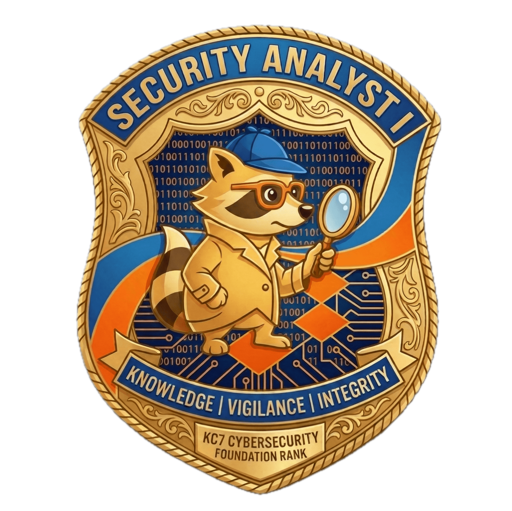

# 🛡️ Security Analyst I — KC7 Cyber Investigations

> KC7 Cyber Foundation Rank - Cybersecurity investigation fundamentals path

---

## Level Completion Badge

**Foundation Rank - Security Analyst I**

* Knowledge · Vigilance · Integrity*
* Verify on KC7 Cyber: [Click Here →](https://kc7cyber.com/badges/earned/63064)*
  

## Important Note

This learning path contains **6 investigations in total**. I have completed all 6 modules, but have selected **4 to document in detail** here - chosen to showcase a diverse range of investigation types, techniques, and scenarios. The remaining 2 (How to Play KC7 + VirusTotal Fundamentals) are foundational skill modules - their concepts are applied throughout the 4 documented investigations below.
  

## Badges Earned - Completed Investigations

| # | Investigation | Date Completed | Badge |
|---|---|---|---|
| 01 | **A Rap Beef: An Intro to Security Investigations** | 2025-02-27 | [`View Badge →`](./assets/badges/new_rap_beef_badge.png) · [Verify Link](https://kc7cyber.com/badges/earned/11842) |
| 02 | **A Scandal in Valdoria: A Political Mystery** | 2025-03-08 | [`View Badge →`](./assets/badges/valdoria-election.png) · [Verify Link](https://kc7cyber.com/badges/earned/12931) |
| 03 | **JoJo's Hospital: A Ransomware Investigation** | 2025-04-01 | [`View Badge →`](./assets/badges/Jojo's_Badge.png) · [Verify Link](https://kc7cyber.com/badges/earned/14801) |
| 04 | **CloutHaus: Social Media Leads to Compromise** | 2026-09-12 | [`View Badge →`](./assets/badges/CH_Badge.png) · [Verify Link](https://kc7cyber.com/badges/earned/57392) |
| 05 | VirusTotal Fundamentals | *(Skill module - no detailed doc)* | [`View Badge →`](./assets/badges/Virustotal_badge.png) · [Verify Link](https://kc7cyber.com/badges/earned/63063) |
| 06 | How to Play KC7 | *(Skill module — no detailed doc)* |  |
  

## Access Documented Case Studies

| # | Case | Difficulty | Status |
|---|---|---|---|
| 01 | [A Rap Beef: An Intro to Security Investigations](./case01-rap-beef/) | Beginner | Complete |
| 02 | [A Scandal in Valdoria: A Political Mystery](./case02-scandal-in-valdoria/) | Beginner → Intermediate | Complete |
| 03 | [JoJo's Hospital: A Ransomware Investigation](./case03-jojos-hospital/) | Beginner → Intermediate | Complete |
| 04 | [CloutHaus: Social Media Leads to Compromise](./case04-clouthaus-afomiya/) | Beginner | Complete |
  

## What I Learned

This path covered core skills: identifying phishing & social engineering, interpreting logs, tracing attacker activity, documenting findings with MITRE ATT&CK mapping, IOC extraction, and writing actionable recommendations.

